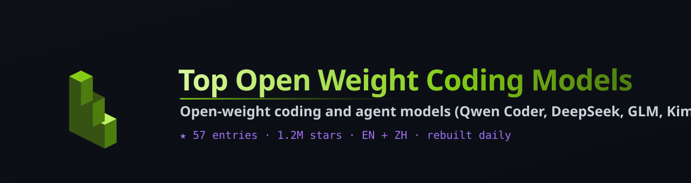

# Top Open Weight Coding Models

<i>Open-weight coding and agent models (Qwen Coder, DeepSeek, GLM, Kimi, Devstral, StarCoder) plus the tools to run them locally: llama.cpp, Ollama, vLLM, MLX, ranked by GitHub stars</i>

  

  

**English** · [简体中文](README.zh-CN.md)

---

## Contents

- [🏆 Top Picks](#top-picks)
- [Local Inference Engines](#sec-1) · 20
- [Open-Weight Coding & Agent Models](#sec-2) · 20
- [Local Coding Agents & IDE Plugins](#sec-3) · 17
- [📖 About this list](#about)

## 🏆 Top Picks

| # | Project | ⭐ Stars | Language | Updated | Description |
|:-:|:--|--:|:-:|:-:|:--|
| 1 | [**ollama/ollama**](https://github.com/ollama/ollama) | 183.7k | Go | 2026-10-18 | Get up and running with Kimi, GLM, MiniMax, DeepSeek, gpt-oss, Qwen, Gemma and other models. |
| 2 | [**ggml-org/llama.cpp**](https://github.com/ggml-org/llama.cpp) | 131.6k | C++ | 2026-10-18 | LLM inference in C/C++ |
| 3 | [**deepseek-ai/DeepSeek-V3**](https://github.com/deepseek-ai/DeepSeek-V3) | 104.5k | Python | 2025-08-28 | — |
| 4 | [**vllm-project/vllm**](https://github.com/vllm-project/vllm) | 94.0k | Python | 2026-10-18 | A high-throughput and memory-efficient inference and serving engine for LLMs |
| 5 | [**deepseek-ai/DeepSeek-R1**](https://github.com/deepseek-ai/DeepSeek-R1) | 91.9k | — | 2025-06-27 | — |

## Local Inference Engines

| # | Project | ⭐ Stars | Language | Updated | Description |
|:-:|:--|--:|:-:|:-:|:--|
| 1 | [**ollama/ollama**](https://github.com/ollama/ollama) | 183.7k | Go | 2026-10-18 | Get up and running with Kimi, GLM, MiniMax, DeepSeek, gpt-oss, Qwen, Gemma and other models. |
| 2 | [**ggml-org/llama.cpp**](https://github.com/ggml-org/llama.cpp) | 131.6k | C++ | 2026-10-18 | LLM inference in C/C++ |
| 3 | [**vllm-project/vllm**](https://github.com/vllm-project/vllm) | 94.0k | Python | 2026-10-18 | A high-throughput and memory-efficient inference and serving engine for LLMs |
| 4 | [**nomic-ai/gpt4all**](https://github.com/nomic-ai/gpt4all) | 77.4k | C++ | 2025-05-27 | GPT4All: Run Local LLMs on Any Device. Open-source and available for commercial use. |
| 5 | [**exo-explore/exo**](https://github.com/exo-explore/exo) | 47.9k | Python | 2026-10-13 | Run frontier AI locally. |
| 6 | [**AlexsJones/llmfit**](https://github.com/AlexsJones/llmfit) | 38.1k | Rust | 2026-10-18 | Hundreds of models & providers. One command to find what runs on your hardware. |
| 7 | [**sgl-project/sglang**](https://github.com/sgl-project/sglang) | 37.3k | Python | 2026-10-18 | SGLang is a high-performance serving framework for large language models and multimodal models. |
| 8 | [**ml-explore/mlx**](https://github.com/ml-explore/mlx) | 28.8k | C++ | 2026-10-16 | MLX: An array framework for Apple silicon |
| 9 | [**mozilla-ai/llamafile**](https://github.com/mozilla-ai/llamafile) | 26.4k | C++ | 2026-10-12 | Distribute and run LLMs with a single file. |
| 10 | [**jundot/omlx**](https://github.com/jundot/omlx) | 22.9k | Python | 2026-10-17 | LLM inference server with continuous batching & SSD caching for Apple Silicon — managed from the macOS menu b… |

Show 10 more

| # | Project | ⭐ Stars | Language | Updated | Description |
|:-:|:--|--:|:-:|:-:|:--|
| 11 | [**Lightning-AI/litgpt**](https://github.com/Lightning-AI/litgpt) | 13.7k | Python | 2026-10-13 | 20+ high-performance LLMs with recipes to pretrain, finetune and deploy at scale. |
| 12 | [**bentoml/OpenLLM**](https://github.com/bentoml/OpenLLM) | 12.6k | Python | 2026-10-12 | Run any open-source LLMs, such as DeepSeek and Llama, as OpenAI compatible API endpoint in the cloud. |
| 13 | [**openvinotoolkit/openvino**](https://github.com/openvinotoolkit/openvino) | 11.0k | C++ | 2026-10-17 | OpenVINO™ is an open source toolkit for optimizing and deploying AI inference |
| 14 | [**RunanywhereAI/runanywhere-sdks**](https://github.com/RunanywhereAI/runanywhere-sdks) | 10.3k | C++ | 2026-10-18 | Production ready toolkit to run AI locally |
| 15 | [**Tiiny-AI/PowerInfer**](https://github.com/Tiiny-AI/PowerInfer) | 9.8k | C++ | 2026-05-11 | High-speed Large Language Model Serving for Local Deployment |
| 16 | [**xorbitsai/inference**](https://github.com/xorbitsai/inference) | 9.6k | Python | 2026-10-18 | Swap GPT for any LLM by changing a single line of code. Xinference lets you run open-source, speech, and mult… |
| 17 | [**FareedKhan-dev/kimi-k3-in-c**](https://github.com/FareedKhan-dev/kimi-k3-in-c) | 9.1k | C | 2026-10-02 | A 2.78-trillion-parameter Kimi K3 running inference on a single CPU in 8.24 GB of RAM. Portable C99: no BLAS,… |
| 18 | [**InternLM/lmdeploy**](https://github.com/InternLM/lmdeploy) | 8.1k | Python | 2026-10-16 | LMDeploy is a toolkit for compressing, deploying, and serving LLMs. |
| 19 | [**ml-explore/mlx-lm**](https://github.com/ml-explore/mlx-lm) | 7.4k | Python | 2026-10-17 | Run LLMs with MLX |
| 20 | [**drumih/turbo-fieldfare**](https://github.com/drumih/turbo-fieldfare) | 6.9k | Swift | 2026-10-15 | Gemma 4 26B-A4B inference in ~2 GB of RAM on any M-series MacBook |

## Open-Weight Coding & Agent Models

| # | Project | ⭐ Stars | Language | Updated | Description |
|:-:|:--|--:|:-:|:-:|:--|
| 1 | [**deepseek-ai/DeepSeek-V3**](https://github.com/deepseek-ai/DeepSeek-V3) | 104.5k | Python | 2025-08-28 | — |
| 2 | [**deepseek-ai/DeepSeek-R1**](https://github.com/deepseek-ai/DeepSeek-R1) | 91.9k | — | 2025-06-27 | — |
| 3 | [**QwenLM/qwen-code**](https://github.com/QwenLM/qwen-code) | 28.6k | TypeScript | 2026-10-18 | An open-source AI coding agent that lives in your terminal. |
| 4 | [**QwenLM/Qwen3**](https://github.com/QwenLM/Qwen3) | 27.7k | Python | 2026-01-09 | Qwen3 is the large language model series developed by Qwen team, Alibaba Cloud. |
| 5 | [**deepseek-ai/DeepSeek-Coder**](https://github.com/deepseek-ai/DeepSeek-Coder) | 24.3k | Python | 2025-11-11 | DeepSeek Coder: Let the Code Write Itself |
| 6 | [**QwenLM/Qwen**](https://github.com/QwenLM/Qwen) | 21.9k | Python | 2026-03-05 | Chinese-language project; see the repo for details |
| 7 | [**QwenLM/Qwen3-Coder**](https://github.com/QwenLM/Qwen3-Coder) | 16.8k | Python | 2026-03-24 | Qwen3-Coder is the code version of Qwen3, the large language model series developed by Qwen team. |
| 8 | [**MoonshotAI/Kimi-K2**](https://github.com/MoonshotAI/Kimi-K2) | 11.1k | — | 2026-01-21 | Kimi K2 is the large language model series developed by Moonshot AI team |
| 9 | [**zai-org/GLM-5**](https://github.com/zai-org/GLM-5) | 7.3k | — | 2026-10-15 | GLM-5: From Vibe Coding to Agentic Engineering |
| 10 | [**deepseek-ai/DeepSeek-LLM**](https://github.com/deepseek-ai/DeepSeek-LLM) | 7.2k | Makefile | 2024-02-04 | DeepSeek LLM: Let there be answers |

Show 10 more

| # | Project | ⭐ Stars | Language | Updated | Description |
|:-:|:--|--:|:-:|:-:|:--|
| 11 | [**deepseek-ai/DeepSeek-Coder-V2**](https://github.com/deepseek-ai/DeepSeek-Coder-V2) | 7.0k | — | 2025-11-11 | DeepSeek-Coder-V2: Breaking the Barrier of Closed-Source Models in Code Intelligence |
| 12 | [**deepseek-ai/DeepSeek-V2**](https://github.com/deepseek-ai/DeepSeek-V2) | 5.0k | — | 2024-09-25 | DeepSeek-V2: A Strong, Economical, and Efficient Mixture-of-Experts Language Model |
| 13 | [**gptme/gptme**](https://github.com/gptme/gptme) | 4.5k | Python | 2026-10-18 | Your agent in your terminal, equipped with local tools: writes code, uses the terminal, browses the web. Make… |
| 14 | [**zai-org/GLM-4.5**](https://github.com/zai-org/GLM-4.5) | 4.4k | Python | 2026-02-01 | GLM-4.5: Agentic, Reasoning, and Coding (ARC) Foundation Models |
| 15 | [**QwenLM/Qwen3.8**](https://github.com/QwenLM/Qwen3.8) | 4.3k | — | 2026-08-17 | Qwen3.8 is the large language model series developed by Qwen team, Alibaba Group. |
| 16 | [**twinnydotdev/twinny**](https://github.com/twinnydotdev/twinny) | 3.7k | TypeScript | 2026-10-16 | Open-source AI coding assistant for VS Code. Coding agent, code completion, chat, edits and reviews with loca… |
| 17 | [**bigcode-project/starcoder2**](https://github.com/bigcode-project/starcoder2) | 2.1k | Python | 2024-03-21 | Home of StarCoder2! |
| 18 | [**huggingface/llm-ls**](https://github.com/huggingface/llm-ls) | 881 | Rust | 2026-09-23 | LSP server leveraging LLMs for code completion (and more?) |
| 19 | [**bin123apple/AutoCoder**](https://github.com/bin123apple/AutoCoder) | 845 | Python | 2024-07-06 | We introduced a new model designed for the Code generation task. Its test accuracy on the HumanEval base data… |
| 20 | [**zinja-coder/jadx-mcp-server**](https://github.com/zinja-coder/jadx-mcp-server) | 805 | Python | 2026-10-09 | MCP server for JADX-AI Plugin |

## Local Coding Agents & IDE Plugins

| # | Project | ⭐ Stars | Language | Updated | Description |
|:-:|:--|--:|:-:|:-:|:--|
| 1 | [**continuedev/continue**](https://github.com/continuedev/continue) | 36.2k | TypeScript | 2026-10-14 | open-source coding agent |
| 2 | [**TabbyML/tabby**](https://github.com/TabbyML/tabby) | 33.9k | Rust | 2026-06-30 | Self-hosted AI coding assistant |
| 3 | [**itayinbarr/little-coder**](https://github.com/itayinbarr/little-coder) | 2.7k | TypeScript | 2026-09-18 | A harness optimized to smaller LLMs |
| 4 | [**ggml-org/llama.vscode**](https://github.com/ggml-org/llama.vscode) | 1.5k | TypeScript | 2026-10-10 | VS Code extension for LLM-assisted code/text completion |
| 5 | [**xNul/code-llama-for-vscode**](https://github.com/xNul/code-llama-for-vscode) | 568 | Python | 2024-07-31 | Use Code Llama with Visual Studio Code and the Continue extension. A local LLM alternative to GitHub Copilot. |
| 6 | [**mlhher/late-cli**](https://github.com/mlhher/late-cli) | 446 | Go | 2026-10-11 | High-performance AI agent for long-horizon tasks and local models. Built on empirical research. 200k+ tokens… |
| 7 | [**plaxtoris/codehamr**](https://github.com/plaxtoris/codehamr) | 220 | Go | 2026-09-25 | A minimal, local-first coding agent for the terminal. |
| 8 | [**autohandai/code-cli**](https://github.com/autohandai/code-cli) | 205 | TypeScript | 2026-10-17 | Open-source terminal coding agent. Use 15+ model providers, local models or your own key. Plan mode before ed… |
| 9 | [**mjasnikovs/pi-task**](https://github.com/mjasnikovs/pi-task) | 144 | TypeScript | 2026-10-16 | Deterministic spec-orchestration for local LLMs in the pi coding agent — drives prompts through refine→resear… |
| 10 | [**nathansutton/chad**](https://github.com/nathansutton/chad) | 139 | Python | 2026-10-13 | chad: a coding agent for your macbook pro |

Show 7 more

| # | Project | ⭐ Stars | Language | Updated | Description |
|:-:|:--|--:|:-:|:-:|:--|
| 11 | [**templetongroup/radiant**](https://github.com/templetongroup/radiant) | 115 | JavaScript | 2026-10-15 | A local coding harness for Mac. Chat with coding agents across cloud and local models, watch every tool call… |
| 12 | [**L-Forster/open-jet**](https://github.com/L-Forster/open-jet) | 97 | Python | 2026-10-14 | An offline coding agent for local models. One command sets up the best model your GPU can run, and on 24 GB+… |
| 13 | [**sergezuber/FABULA-LLM-5**](https://github.com/sergezuber/FABULA-LLM-5) | 82 | TypeScript | 2026-09-22 | A local-first coding agent that doesn't take "done" on faith: the engine keeps the run going until the projec… |
| 14 | [**Ninnix/q36**](https://github.com/Ninnix/q36) | 71 | C | 2026-10-16 | Qwen3.8-27b and Qwen3.6-35B-A3B local inference engine for Vulkan and Metal |
| 15 | [**raullenchai/rapid-mlx-dsh-provider**](https://github.com/raullenchai/rapid-mlx-dsh-provider) | 70 | JavaScript | 2026-08-19 | Native Rapid-MLX provider for DeepSeek Harness (dsh) — dsh reads model facts from the server instead of your… |
| 16 | [**MuhammadUsmanGM/code-stick**](https://github.com/MuhammadUsmanGM/code-stick) | 63 | TypeScript | 2026-05-21 | Plug in a USB. Get an offline AI coding agent on any laptop - Windows, macOS, Linux. opencode + Ollama, pre-b… |
| 17 | [**Fangyuan025/Chaty**](https://github.com/Fangyuan025/Chaty) | 52 | TypeScript | 2026-10-14 | The models on your disk, put to work. A private desktop app for open models — chat, a coding agent built for… |

## 📖 About this list

This list is collected from GitHub, deduplicated, link-checked and ranked by stars (recency breaks ties). It is regenerated automatically on a schedule, so numbers stay fresh.

---

Auto-generated · refreshed on a schedule · ranked by GitHub stars · 2026-10-18

